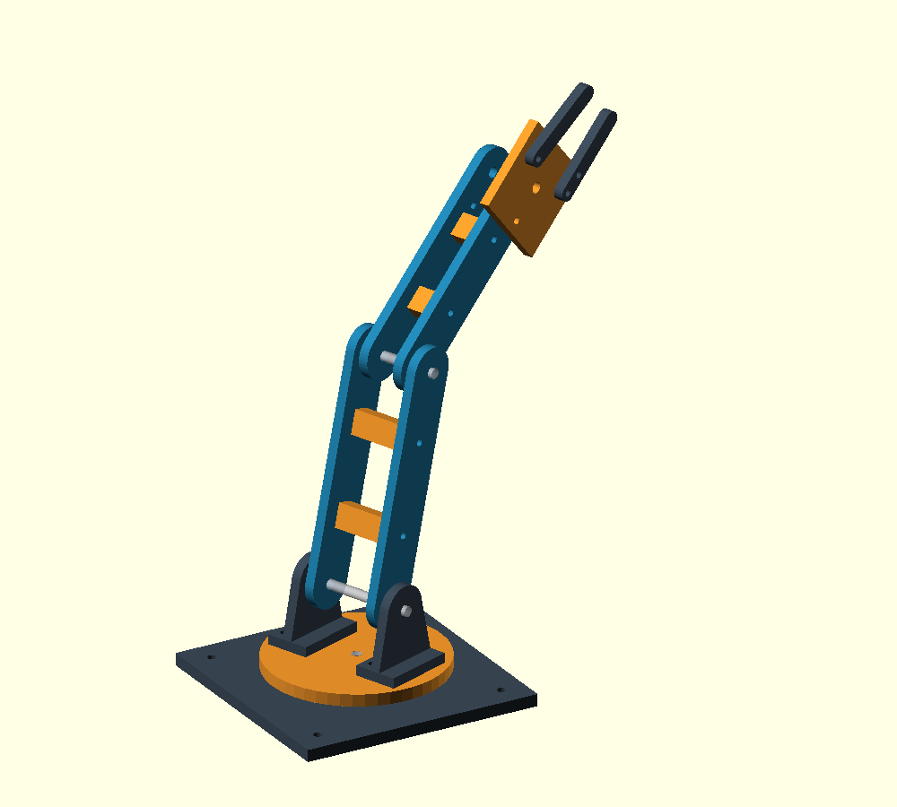

# Braço mecânico — Sistemas Embarcados

Protótipo acadêmico com base, ombro, cotovelo e garra, estrutura modular impressa na **Ender 3 original (220 × 220 × 250 mm)** e futuro controle por ESP32. Esta versão entrega CAD e documentação; firmware e interface web ainda não foram implementados.

**Estado: conceito verificável, não liberado para impressão definitiva.** Os furos genéricos são hipóteses, não encaixes de servos comerciais. Faltam atuadores, transmissão, rolamentos/buchas, ferragens, medições e ensaios.

## Começar

1. Abra `cad/main.scad` no OpenSCAD e pressione F5.
2. Altere `part` para uma peça ou `"exploded"` para a vista explodida.
3. Edite dimensões em `cad/parameters.scad`; registre medições em `docs/componentes.md` antes de criar interfaces reais.
4. Para STL, selecione uma peça isolada, pressione F6 e use **File → Export → Export as STL**.
5. Na raiz do repositório, verifique os conceitos:

```powershell
python scripts/verify.py
python scripts/torque.py
```

O verificador procura OpenSCAD no PATH e na instalação padrão do Windows; aceita `--openscad "caminho/openscad"`. Gera STL, imagens e relatório em `build/` (ignorado pelo Git). Requer Python 3.10+ e OpenSCAD 2021.01+, sem bibliotecas Python externas.

| Caminho | Responsabilidade |
| --- | --- |
| `cad/parameters.scad` | Dimensões conceituais, folgas e verificações |
| `cad/lib/parts.scad` | Sólidos reutilizáveis e orientação de exportação |
| `cad/lib/assembly.scad` | Poses, montagem e referências não imprimíveis |
| `cad/main.scad` | Seletor de peças e vistas |
| `docs/` | Requisitos, componentes, cálculos e validação |
| `scripts/` | Exportação/verificação e cálculo de torque |
| `firmware/`, `web/` | Escopo futuro, sem implementação |

Leia [requisitos](docs/requisitos.md), [arquitetura](docs/arquitetura.md), [componentes](docs/componentes.md), [avaliação mecânica](docs/mecanica.md), [guia CAD/STL](docs/modelagem.md) e [resultados](docs/validacao.md).

A meta de aproximadamente 30 cm corresponde à posição estendida vertical. A pose inicial dobrada é mais baixa. Não há punho: a garra tem um dedo fixo e outro móvel. O mecanismo de acionamento ainda não está dimensionado.


