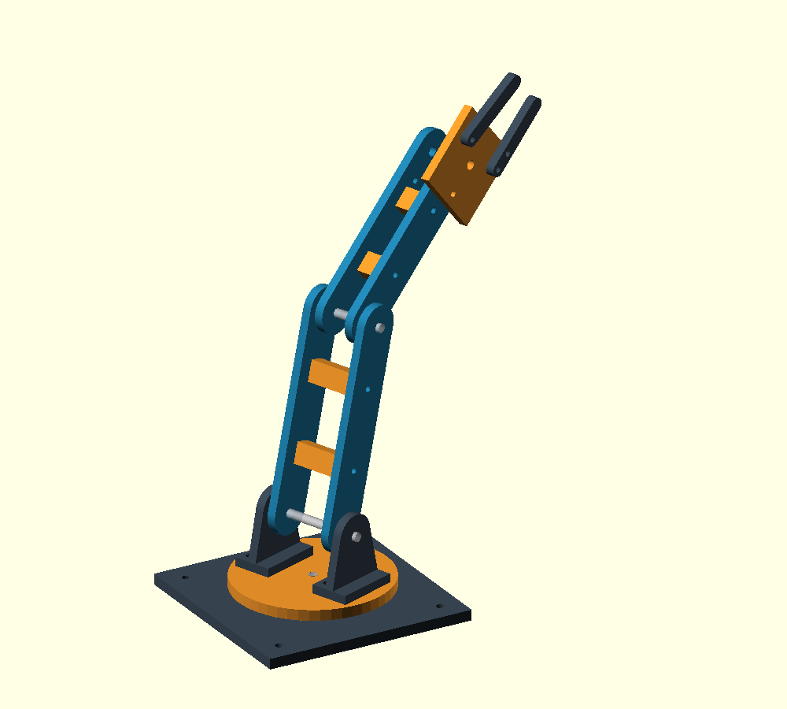
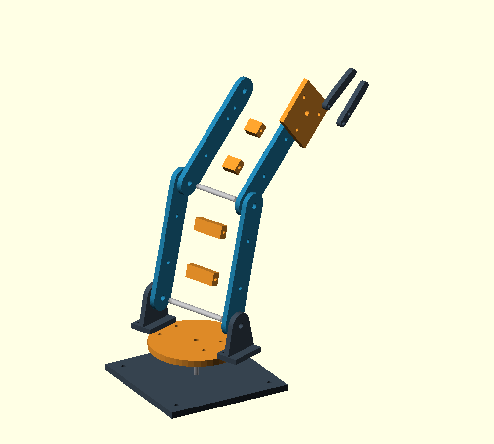

# Verificação da versão conceitual

Execução em **11/11/2026**, Windows/PowerShell, Python **3.12.10**, **OpenSCAD 2021.01** (`C:\Program Files\OpenSCAD\openscad.com`). Estado inicial: repositório com apenas README, commit `4437e69`. Não foram implementados firmware ou interface web.

## Comandos e resultados

| Verificação | Resultado observado |
| --- | --- |
| `python scripts/verify.py` | Código de saída 0, relatório `passed` |
| 11 tipos de peça em STL binário | Exportados sem ERROR/WARNING do OpenSCAD |
| Malhas individuais | Um componente conectado por peça; cada aresta com duas incidências, orientação consistente, sem triângulo degenerado, volume positivo |
| Envelope e orientação | Todas dentro de 210 × 210 × 250 mm (margem XY de 5 mm por lado); Z mínimo zero |
| Variante paramétrica | As 11 peças passaram com elos 120/90 mm, espessura 6 mm e acréscimo diametral de 0,6 mm |
| Resposta ao parâmetro de folga | Base com acréscimo de 0,8 mm apresentou redução do volume dos sólidos em relação ao padrão de 0,4 mm |
| Entradas inválidas | Folga negativa, placas do cotovelo sobrepostas, base de 230 mm e seletor de peça desconhecido rejeitados por assertion |
| Quatro vistas CSG/PNG | Montagem, explodida, vertical e horizontal geradas sem avisos/erros |
| Inspeção visual das quatro imagens | Placas duplas, espaçadores, apoios e dedos visíveis; pose e separação conceitual coerentes; não substitui análise de colisão |
| `python scripts/torque.py` | Código de saída 0; resultados abaixo; aumento de carga elevou torque nos dois eixos |
| `python -m py_compile scripts/verify.py scripts/torque.py` | Sem erros de sintaxe |
| `git diff --check` | Sem erros de whitespace; Git informou conversão futura de LF para CRLF no README |
| Conferência dos 20 arquivos do projeto | Links Markdown locais resolvidos e textos sem whitespace final; confirmados 23 STL de teste e 15 peças estruturais |

Os avisos/erros nos quatro logs `invalid_*` são **esperados**, fazem parte dos testes negativos. Não representam falha da execução. Foram produzidos 23 STL válidos (11 padrão, 11 da variante e uma base para comparação de folga), além das quatro imagens e arquivos CSG. Não confundir quantidade de arquivos de teste com quantidade de peças para montagem.

## Dimensões verificadas dos STL padrão

| Peça | X × Y × Z (mm) | Quantidade no braço |
| --- | --- | ---: |
| Base | 120 × 120 × 6 | 1 |
| Prato | 88 × 88 × 6 | 1 |
| Pedestal | 36 × 22 × 42 | 2 |
| Lateral superior | 134 × 24 × 5 | 2 |
| Lateral do antebraço | 124 × 24 × 5 | 2 |
| Espaçador superior | 12 × 8 × 31 | 2 |
| Espaçador do antebraço | 12 × 8 × 15 | 2 |
| Palma | 46 × 48 × 5 | 1 |
| Dedo fixo | 48 × 8 × 5 | 1 |
| Dedo móvel | 48 × 8 × 5 | 1 |
| Cupom | 60 × 20 × 5 | 0 (ensaio separado) |

## Resultados mecânicos de cenário

Com massas assumidas e carga de 50 g, braço horizontal:

- Ombro: 0,572218 N·m estático; alvo exploratório com fator 2 de 1,144436 N·m (11,67 kgf·cm).
- Cotovelo: 0,216237 N·m estático; alvo exploratório com fator 2 de 0,432473 N·m (4,41 kgf·cm).
- Base livre: razão restauradora/tombamento 0,513, insuficiente no cenário. A decisão é ancorar à bancada e dimensionar a fixação.
- Altura vertical conceitual calculada: 308 mm. Não foi medida em peça física.

As hipóteses e limitações estão em [mecanica.md](mecanica.md). Não são especificações finais de servos ou comprovação de capacidade.

## Evidências reproduzíveis

`build/verification.json` contém ferramenta, dimensões, volumes, triângulos e resultados. `build/torque.json` guarda entradas e cálculos. Logs individuais, STL, CSG e PNG ficam em `build/`, ignorados pelo Git. Os scripts recriam esses artefatos; `--skip-images` muda a cobertura e deve ser declarado ao registrar outra execução.

As imagens em `docs/images/` são cópias da última inspeção com os parâmetros padrão; atualizar após mudanças no CAD. A montagem usa prévia OpenCSG, enquanto cada STL individual foi efetivamente renderizado pelo exportador de sólidos.

## O que continua sem validação física

| Item | Evidência exigida para avançar |
| --- | --- |
| Servos e interfaces | Modelo, ficha técnica, medidas reais, horn e acesso aos fixadores |
| Base giratória | Apoio axial/radial, acoplamento, retenção e capacidade de reagir ao momento |
| Ombro/cotovelo | Eixos, buchas/rolamentos, espaçadores axiais, retenção e suporte do torque |
| Garra | Transmissão do atuador, batentes, força de preensão, material de contato e torção da palma |
| Impressão | Fatiamento, perfil calibrado, cupom medido e resistência da orientação escolhida |
| Carga e rigidez | Massas reais, deflexão, aquecimento, folga e ciclos sob cargas progressivas |
| Estabilidade | Fixação/bancada dimensionadas, ausência de deslizamento e de levantamento dos apoios |
| Curso e cabos | Inspeção de interferências em toda a faixa e alívio de tração |
| Elétrica e controle | Fonte, queda de tensão, corrente, corte, calibração e estados de falha, em etapa posterior |

O verificador não detecta todas as auto-interseções, colisões, regiões finas, problemas de fatiamento ou fragilidades mecânicas. Não houve impressão, ensaio estrutural, teste com servos ou validação elétrica. **Esta versão permanece conceitual e não está liberada para impressão definitiva.**
